<div align="center">

<a href="https://tanujchandra.github.io/tanujchandra/">
  
</a>

<br/><br/>

<table>
  <tr>
    <td align="center">
      <a href="https://tanujchandra.github.io/tanujchandra/">
        
      </a>
      <h2>Tanuj Chandra</h2>
      <p><strong>Principal DevSecOps Architect &amp; Enterprise Cloud Security Lead</strong></p>
      <p><em>12+ Years Architecting Zero-Trust Cloud Platforms, Hardened Kubernetes &amp; Shift-Left Resilience</em></p>
    </td>
  </tr>
</table>

<br/>

[](https://tanujchandra.github.io/tanujchandra/)
[](https://www.linkedin.com/in/tanujchandra)
[](mailto:tanujchandra@gmail.com)
[](https://github.com/tanujchandra)
[](#)

---

</div>

## 📌 Executive Profile

**Principal DevSecOps Architect & Cloud Security Leader** with over **12 years of hands-on and strategic experience** engineering zero-trust cloud infrastructure, shift-left application security frameworks, and resilient continuous delivery pipelines. 

Specializing in bridging Software Development, Security Operations (SecOps), and Site Reliability Engineering (SRE) to eliminate vulnerabilities early in the software development lifecycle (SDLC) while accelerating deployment velocity for mission-critical enterprise workloads.

### Core Architecture Competencies
* **Shift-Left Security & DevSecOps Culture:** Embedding automated security quality gates (SAST, DAST, SCA, Secrets Scanning) directly into developer workflows.
* **Enterprise Cloud Infrastructure as Code:** Architecting immutable, multi-region architectures on **AWS**, **Azure**, and **GCP** utilizing modular Terraform and OpenTofu.
* **Container & Kubernetes Defense:** Multi-tenant cluster hardening, strict Pod Security Standards (PSS), eBPF-based runtime observability (Cilium, Falco), and admission control validation (Kyverno, OPA Gatekeeper).
* **Software Supply Chain Security:** Hardening supply chains to **SLSA Level 3+** through automated SBOM generation (Syft), provenance verification, and cryptographic artifact signing (Cosign / Sigstore).
* **Policy as Code & Governance:** Automating compliance verification against **SOC 2 Type II, ISO 27001, PCI-DSS, NIST 800-53, and CIS Benchmarks**.

---

## 🔄 End-to-End DevSecOps Delivery Architecture

The following pipeline architecture reflects the zero-trust software supply chain standard deployed across enterprise multi-cloud environments:


---

## 🛠️ Enterprise Technology Matrix

| Domain | Production Tooling & Platforms |
| :--- | :--- |
| **Cloud Platforms** | Amazon Web Services (EKS, IAM, KMS, VPC, GuardDuty, CloudTrail), Microsoft Azure (AKS), Google Cloud Platform (GKE) |
| **Infrastructure as Code** | Terraform, OpenTofu, Terragrunt, Ansible, Packer, AWS CloudFormation |
| **Container & Orchestration** | Kubernetes (EKS/AKS/GKE), Docker, Helm, ArgoCD, Flux, Istio Service Mesh, Cilium (eBPF CNI) |
| **Shift-Left Security & AppSec** | Snyk, SonarQube Enterprise, Trivy, Checkov, OWASP ZAP, GitGuardian, HashiCorp Vault, Gitleaks |
| **Supply Chain Security** | Sigstore / Cosign, Syft (SPDX/CycloneDX SBOM), In-Toto, SLSA Framework (Level 3+) |
| **Policy as Code & Compliance** | Open Policy Agent (OPA / Rego), Kyverno, DefectDojo, CIS Benchmarks, NIST 800-53 |
| **Observability & SecOps SRE** | Prometheus, Grafana, Datadog APM, Splunk Enterprise, ELK Stack, Falco, PagerDuty |
| **Scripting & CI/CD Systems** | Python, Go (Golang), Bash, PowerShell, GitHub Actions, GitLab CI/CD, Jenkins, Tekton |

---

## 🎯 Measurable Architectural Accomplishments

| Business & Engineering Objective | Strategic Initiative & Enterprise Result |
| :--- | :--- |
| **Vulnerability Reduction** | Standardized automated shift-left scanning gates across **500+ microservices**, reducing high-severity production vulnerabilities by **75%** and decreasing mean time to remediate (MTTR) to under 24 hours. |
| **Infrastructure Scalability** | Designed modular Terraform and Terragrunt modules managing multi-region cloud workloads, eliminating configuration drift and cutting cloud infrastructure provisioning lead time from days to minutes. |
| **Zero-Trust Cluster Topologies** | Hardened multi-tenant Kubernetes clusters utilizing Cilium eBPF network policies, strict Pod Security Standards (PSS), and automated HashiCorp Vault dynamic secret injection. |
| **Supply Chain Integrity** | Implemented SLSA Level 3 compliance pipelines utilizing automated SBOM generation (Syft) and cryptographic Cosign attestation, preventing unauthorized container images from entering production clusters. |
| **Compliance & Audit Automation** | Automated continuous compliance evidence collection for **SOC 2 Type II, ISO 27001, and PCI-DSS**, converting weeks of manual spreadsheet audits into continuous real-time compliance dashboards. |

---

## 🏆 Verified Accreditations & Certifications

- 🎖️ **Certified Kubernetes Security Specialist (CKS)** — *Cloud Native Computing Foundation (CNCF)*
- 🎖️ **Certified Kubernetes Administrator (CKA)** — *Cloud Native Computing Foundation (CNCF)*
- 🎖️ **AWS Certified Security – Specialty** — *Amazon Web Services (AWS)*
- 🎖️ **AWS Certified Solutions Architect – Professional** — *Amazon Web Services (AWS)*
- 🎖️ **HashiCorp Certified: Terraform Associate** — *HashiCorp*
- 🎖️ **Information Systems Security Architecture** — *Alignment with ISC² CISSP Domains*

---

## 📈 Career Evolution (12 Years)

```
2022 — PRESENT | Lead DevSecOps Architect & Cloud Security Strategist
                 Enterprise Zero-Trust, SLSA L3+ Supply Chain, eBPF Kernel Observability, FinOps
2018 — 2022    | Senior DevSecOps & Kubernetes Infrastructure Engineer
                 Multi-tenant EKS/AKS Hardening, HashiCorp Vault Automation, ArgoCD GitOps
2015 — 2018    | Cloud DevOps & Infrastructure Automation Specialist
                 AWS Cloud Migration, Terraform IaC Standardization, CI/CD Hardening, Docker
2012 — 2015    | Systems & Network Security Engineer
                 High-Availability Linux Clusters, Network Firewalls, Intrusion Detection (IDS/IPS)
```

---

## 🤝 Professional Inquiries & Advisory

Available for strategic advisory, enterprise DevSecOps transformation consulting, and senior engineering leadership engagements.

- 💼 **LinkedIn:** [linkedin.com/in/tanujchandra](https://www.linkedin.com/in/tanujchandra)
- 📧 **Direct Email:** [tanujchandra@gmail.com](mailto:tanujchandra@gmail.com)
- 🌐 **Interactive 3D Portfolio:** [tanujchandra.github.io/tanujchandra](https://tanujchandra.github.io/tanujchandra/)

---

<div align="center">
  <sub>Architected with Zero-Trust Principles • Policy as Code • Continuous Governance</sub>
</div>
